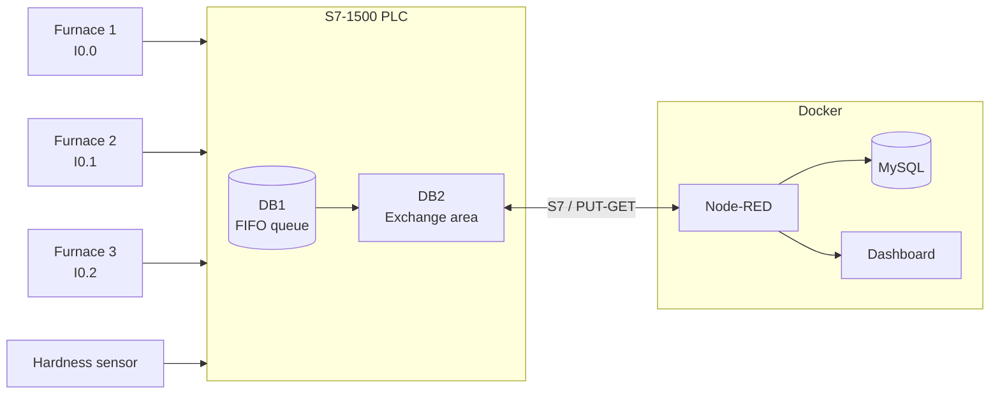
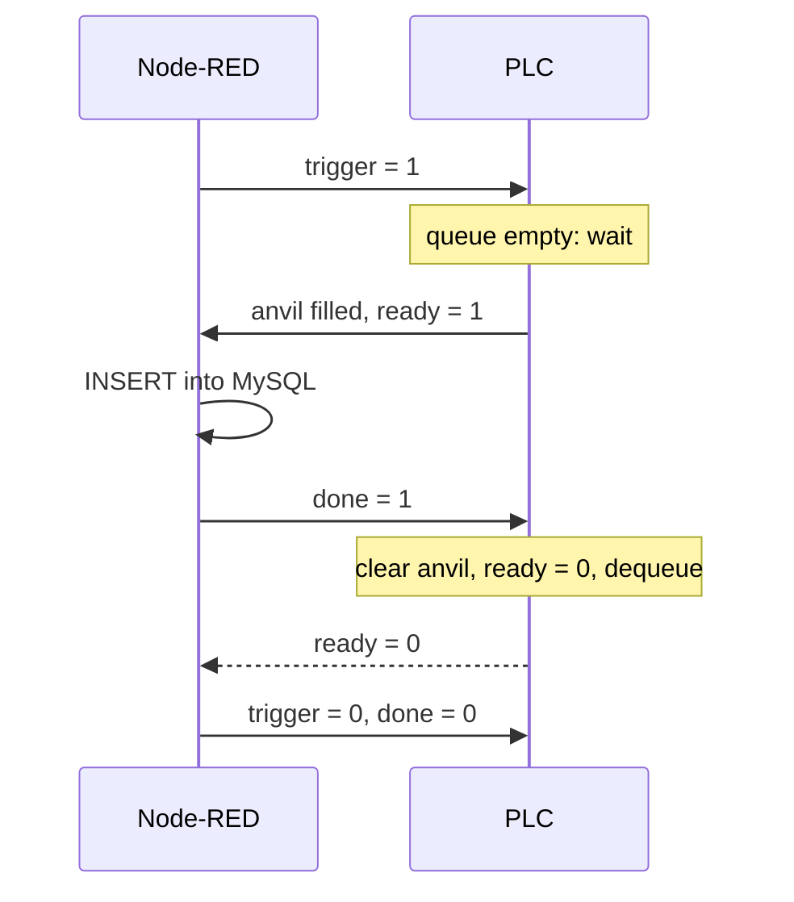

Traceability for an anvil production line. Every anvil delivered by one of three
furnaces is queued in the PLC with its furnace number, timestamp and the hardness
measured at that moment. Node-RED pulls anvils out one at a time through a handshake,
stores them in MySQL and serves a dashboard for the production team.

## Architecture



## Features

| Feature | Where |
|---|---|
| FIFO queue with furnace, timestamp and hardness | `FC_EnqueueAnvil`, `DB_AnvilQueue` |
| Fixed exchange area for external systems | `DB_AnvilProcess` (non-optimized access) |
| trigger / ready / done handshake | OB1 + `handshake` function in Node-RED |
| Storage with production and storage timestamps | `products` table |
| Real-time hardness | Dashboard gauge |
| Anvils per furnace | Dashboard bar chart |
| Hardness of the last 20 anvils | Dashboard line chart |
| Furnace registry (list, create, edit, delete) | Dashboard page *Fornalhas*, `furnaces` table |

## Getting started

Requires Docker with Compose.

```bash
cp .env.example .env          # passwords and PLC address
docker compose up -d --build
```

| | |
|---|---|
| Node-RED editor | http://localhost:1880 |
| Dashboard | http://localhost:1880/dashboard |
| Furnace registry | http://localhost:1880/dashboard/fornalhas |

MySQL applies the migrations in `db/migrations` on first start. The Node-RED image ships
with the S7, MySQL and Dashboard 2.0 nodes preinstalled.

## PLC

TIA Portal V20, CPU 1511-1 PN. The project is archived in `plc/Anvil_works.zap20`
(open with *Project > Retrieve*).

| Block | Role |
|---|---|
| OB1 (LAD) | Furnace edge detection, anvil hand-off, queue removal |
| AI 8xU/I/RTD/TC ST (slot 3) | Hardness sensor on `%IW2`, copied to `DB2.hardnessSensor` every cycle (unscaled, sensor range not specified) |
| `FC_EnqueueAnvil` (SCL) | Writes to the circular queue, validates furnace id, handles full queue |
| `DB_AnvilQueue` (DB1) | 10-slot queue with `readIndex`, `writeIndex` and `count` |
| `DB_AnvilProcess` (DB2) | Area read and written by Node-RED |

| Variable | Address |
|---|---|
| hardnessSensor | DB2.DBW0 |
| trigger | DB2.DBX2.0 |
| ready | DB2.DBX2.1 |
| done | DB2.DBX2.2 |
| anvil.furnace | DB2.DBW4 |
| anvil.timestamp | DB2.DTL6 |
| anvil.hardness | DB2.DBW18 |

Connection: rack 0, slot 1, with PUT/GET enabled on the CPU.

## Handshake



Node-RED reads DB2 bytes 0–19 every 500 ms in a single request, so the signals and the
anvil data always come from the same PLC snapshot.

## Design decisions

**Level-triggered request.** If Node-RED asks while the queue is empty, the request stays
pending and the PLC serves it as soon as an anvil arrives. An edge-triggered request would
be lost and the handshake would stall.

**`done` only counts while `ready` is high.** A stray `done` never decrements the queue or
moves the read index.

**No duplicate inserts.** A flag (`flow.busy`) is set on INSERT and cleared only when the
PLC drops `ready`. If the INSERT fails, the flag is released and the same anvil is retried
on the next poll.

**UTC end to end.** The PLC stamps anvils with `RD_SYS_T` (UTC), Node-RED reads the field
as `DTLZ`, and MySQL stores it unchanged. Production and storage times share one time base.

**Configuration through the environment.** MySQL credentials and the PLC address come from
`.env`. The versioned `flows_cred.json` holds only references such as `${MYSQL_USER}`,
never actual values.

## Testing

**PLC, on S7-PLCSIM V20:**
- Pulses on all three furnaces, one record per rising edge
- Sensor hardness captured at the moment of the pulse
- Queue full at 10 slots, without overwriting records
- `done` without `ready` leaves the queue untouched
- Full trigger → ready → done → reset cycle, driven manually

**Node-RED:** the *testes sem CLP* group has two inject nodes that reproduce DB2 reads.
They were used to validate the INSERT, the duplicate guard and the signal reset.
The furnace registry was tested from the dashboard (create, edit, delete); a duplicate
PLC id is rejected by a unique constraint.

## Known limitations

**End-to-end test.** S7-PLCSIM V20 Standard does not accept external connections; TCP/IP
mode is limited to PLCSIM Advanced instances. Node-RED ↔ PLC was validated on each side,
not together. With a physical PLC or PLCSIM Advanced, only `PLC_HOST` needs to change.

**Queue full.** With 10 anvils pending, new pulses are rejected and that record is lost.
This only happens if Node-RED stops consuming for long enough.
